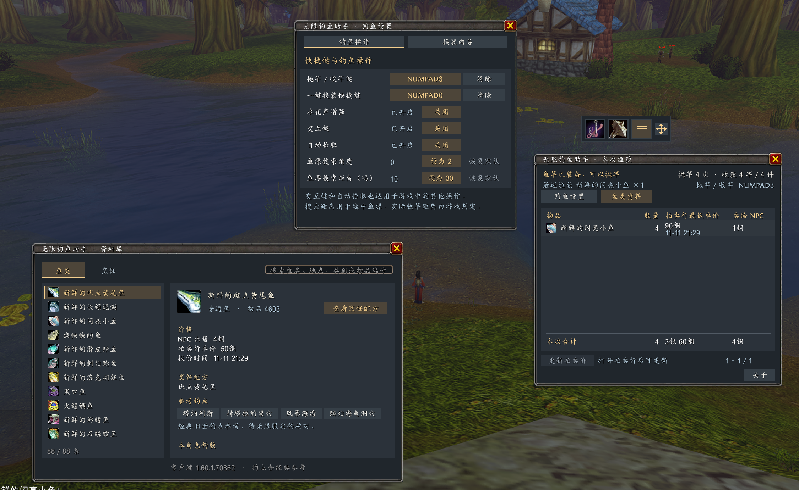

# BobberTally

[简体中文](README.md) · **English**

BobberTally is a fishing add-on for **World of Warcraft: Forever**. Swap between your fishing pole and weapons, track what you catch, compare Auction House listings with vendor prices, and look up fishing spots and cooking recipes.

**[Download v0.7.0 ZIP](https://github.com/bluexp/bobber-tally/releases/download/v0.7.0/BobberTally-v0.7.0.zip)** · [Installation guide on WFDB](https://wfdb.cc/en/addons/bobber-tally/)

Requires the WoW Forever client (add-on interface `16001`). The add-on supports English and Simplified Chinese.

## Features

| Feature | What you can do |
| --- | --- |
| Fishing toolbar | Click the equipment icon to swap gear or the hook to cast. The bar chart opens catch statistics and the cog opens Fishing Settings. Drag the four-way arrow to move the toolbar. |
| Gear sets | Check both hand slots and the latest swap result. A swap succeeds once both slots match the target. Failed swaps show a reason. |
| Fishing Settings | Set gear swap and cast/reel bindings, boost the splash sound, and adjust Interact Key, Auto Loot, and bobber search. Bindings support the numpad and mouse side buttons. |
| Catch tracking and price estimates | See casts, catches, fishing time, estimated values, and hourly rates. Click **Refresh Prices** on the Auction House **Buy** page to see lookup progress and results. |
| Fish and cooking catalog | Browse 88 fish entries and 24 recipes. Filter fish by your current zone, open fishing spots on the map, and set catch goals. |

## Installation and setup

1. Download and unzip the add-on. Copy the extracted `WowfFishing` folder to `_forever_/Interface/AddOns/`.
2. Restart the game and enable **BobberTally** (shown as **无限钓鱼助手** on Chinese clients) in the AddOns list at character selection.
3. Run `/wowfish setup`. Choose your fishing pole and the weapon you want to switch back to, then record a swap key. The wizard waits for the game to confirm each gear change. Close the Equipment Manager before saving.
4. Run `/wowfish settings`. Under **Fishing Controls**, set a **Cast / Reel Key** and enable **Interact Key**. To record a mouse side button, keep the pointer over the binding field while pressing it. With your pole equipped, press the key to cast, then press it again after the splash to reel in.

If a key is already bound in the game, choose **Use Anyway** to override it temporarily. Click **Clear** to restore the original binding.

## In-game commands

| Command | What it does |
| --- | --- |
| `/wowfish` or `/wowfish loot` | Open the catch and price estimates panel. |
| `/wowfish setup` | Open the gear swap wizard. |
| `/wowfish gear` | View gear sets and the latest swap result. |
| `/wowfish settings` | Open Fishing Settings. |
| `/wowfish fish` | Open the fish and cooking catalog. |
| `/wowfish bind G` | Bind the cast/reel action. Replace `G` with an available key. |
| `/wowfish about` | Open the in-game help and credits. |

## Interface language

BobberTally follows the client language by default. To change the add-on language for the current character, run one of these commands, then run `/reload`:

| Command | Language |
| --- | --- |
| `/wowfish lang en` | English |
| `/wowfish lang zh` | Simplified Chinese |
| `/wowfish lang auto` | Client default |

Game item tooltips and equipment links still use the client language.

## In-game screenshot

Fishing Settings, the catch panel, and the fish catalog open together in v0.6.0.

## Data and credits

Session catches survive logout and UI reload. Click **End Session** to start fresh. The game saves settings, Auction House quotes, and catch locations locally for each character. Auction estimates use the lowest unit price found at the time of lookup. Catch totals show how many items have no price. The catalog credits its reference locations and shows your character’s catches separately.

Thanks to the add-on authors, data maintainers, and players whose work helped build the catalog and verify game behavior. See the [full usage notes and sources (Chinese)](addons/WowfFishing/README.md), [third-party license notices](addons/WowfFishing/THIRD_PARTY_LICENSES.txt), and [policy and code review (Chinese)](COMPLIANCE.md).
