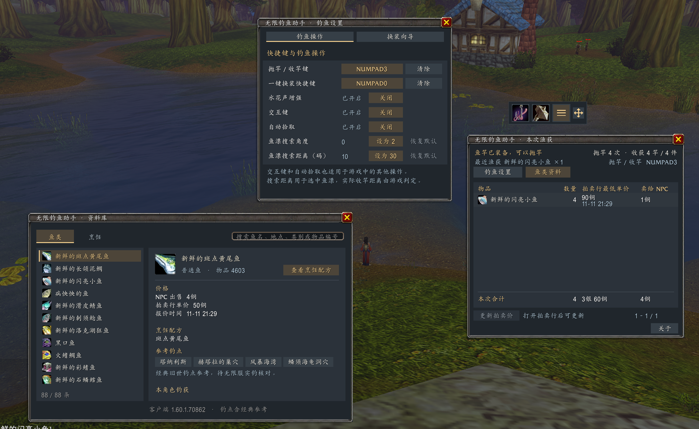

# BobberTally

[简体中文](README.md) · **English**

BobberTally is a fishing add-on for **World of Warcraft: Forever**. Swap between your fishing pole and weapons, track what you catch, compare Auction House listings with vendor prices, and look up fishing spots and cooking recipes.

**[Download v0.11.6 ZIP](https://github.com/bluexp/bobber-tally/releases/download/v0.11.6/BobberTally-v0.11.6.zip)** · [Installation guide on WFDB](https://wfdb.cc/en/addons/bobber-tally/)

Requires the WoW Forever client (add-on interface `16001`). The add-on supports English and Simplified Chinese.

BobberTally is the in-game add-on for [WFDB](https://wfdb.cc/en/). The [fishing database](https://wfdb.cc/en/fishing/) provides fishing spots, recipes, and contribution previews. The [Mac client](https://wfdb.cc/en/downloads/#macos) installs and updates the add-on and prepares catch records for submission.

## License and attribution

Original add-on code and accompanying documentation use the [BobberTally Noncommercial Attribution License 1.0](LICENSE): **no commercial use; noncommercial personal use, study, modification, and free sharing require preserved attribution.** Keeping the supplied notices is sufficient for private use. Public copies must credit `BobberTally · originally by bluexp · https://github.com/bluexp/bobber-tally`; modified versions must also identify their changes and include complete readable source.

This is a custom **source-available license**, not an OSI open-source license. See the full terms for scope and obligations; other WFDB products are excluded. FishDex data retains MIT permissions and other third-party rights remain intact. Only copies expressly carrying the new terms are covered; existing release archives and tags are preserved. [Attribution notice](NOTICE) · [Licensing FAQ and commercial boundaries](addons/WowfFishing/LICENSING.md) · [Contributing](CONTRIBUTING.md)

## Features

| Feature | What you can do |
| --- | --- |
| Fishing toolbar | Click the equipment icon to swap gear or the hook to cast. The bar chart opens catch statistics and the cog opens Fishing Settings. Drag the four-way arrow to move the toolbar. |
| Gear sets | Check both hand slots and the latest swap result. A swap succeeds once both slots match the target. Failed swaps show a reason. |
| Fishing Settings | Set gear swap and cast/reel bindings, boost the splash sound, and adjust Interact Key, Auto Loot, and bobber search. Bindings support the numpad and mouse side buttons. |
| Catch tracking and price estimates | See casts, catches, fishing time, estimated values, and hourly rates. Auction prices refresh on opening by default. Turn this off in Fishing Controls or refresh manually. |
| My Auctions | Track active fish listings, confirmed sales, and daily records, and get sale alerts. Open the mailbox to sync settled proceeds. |
| Catch and cooking catalog | Browse 89 catches and 24 recipes. Filter by your current zone or by non-fish catches, check reference sources, open the map, and set catch goals. |

## Installation and setup

1. Download and unzip the add-on. Copy the extracted `WowfFishing` folder to `_forever_/Interface/AddOns/`.
2. Restart the game and enable **BobberTally** (shown as **无限钓鱼助手** on Chinese clients) in the AddOns list at character selection.
3. Run `/wowfish setup`. Choose your fishing pole and the weapon you want to switch back to, then record a swap key. The wizard waits for the game to confirm each gear change. Close the Equipment Manager before saving.
4. Run `/wowfish settings`. Under **Fishing Controls**, set a **Cast / Reel Key**. Use numpad, navigation, punctuation, or key combinations. Keep the pointer over the binding field to record a middle button, side button, or wheel direction. Both Enter keys are reserved and Esc cancels recording. With your pole equipped, press the key to cast, then press it again after the splash to reel in.

You can record a key that is already bound in WoW. BobberTally overrides it temporarily. Change keys or click **Clear** to restore the original action. If you assign the same key to both add-on actions, the last one you save gets it.

v0.11.6 enables Interact Key automatically the first time it loads for each game account. You can turn it off in Fishing Controls. Your choice persists when you reload the UI or switch characters.

## In-game commands

| Command | What it does |
| --- | --- |
| `/wowfish` or `/wowfish loot` | Open the catch and price estimates panel. |
| `/wowfish setup` | Open the gear swap wizard. |
| `/wowfish gear` | View gear sets and the latest swap result. |
| `/wowfish settings` | Open Fishing Settings. |
| `/wowfish auctions` | View active listings, confirmed sales, and daily records. |
| `/wowfish fish` | Open the fish and cooking catalog. |
| `/wowfish export` | Export recent fishing records for preview in the WFDB fishing database. |
| `/wowfish bind G` | Bind the cast/reel action. Replace `G` with the key you want to use. |
| `/wowfish about` | Find WFDB website addresses, in-game help, and credits. |

## Interface language

BobberTally follows the client language by default. To change the add-on language for the current character, run one of these commands, then run `/reload`:

| Command | Language |
| --- | --- |
| `/wowfish lang en` | English |
| `/wowfish lang zh` | Simplified Chinese |
| `/wowfish lang auto` | Client default |

Game item tooltips and equipment links still use the client language.

## In-game screenshot

Fishing Settings, the catch panel, and the fish catalog open together in v0.6.0.

## Data and credits

Session catches survive logout and UI reload. Click **End Session** to start fresh. The game saves settings, Auction House quotes, sale and settlement records, and catch locations locally for each character. Auction estimates use the lowest unit price found at the time of lookup. Catch totals show how many items have no price. The catalog credits its reference locations and shows your character’s catches separately.

Thanks to the add-on authors, data maintainers, and players whose work helped build the catalog and verify game behavior. See the [full usage notes and sources (Chinese)](addons/WowfFishing/README.md), [third-party license notices](addons/WowfFishing/THIRD_PARTY_LICENSES.txt), and [policy and code review (Chinese)](COMPLIANCE.md).
