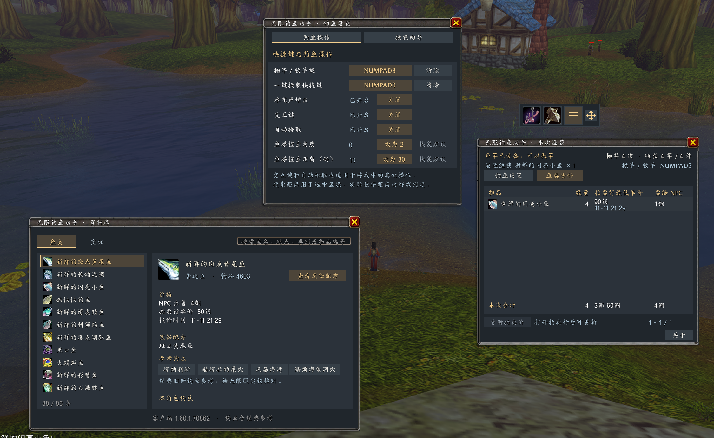

# BobberTally · 无限钓鱼助手

**简体中文** · [English](README.en.md)

为《魔兽世界：无限》设计的钓鱼插件。用工具栏切换装备和抛竿，查看本次渔获的估价，并在资料库里查找鱼类、钓点和烹饪配方。

*A fishing add-on for World of Warcraft: Forever with gear swaps, catch tracking, and a fish and cooking catalog.*

**[下载 v0.7.0 ZIP](https://github.com/bluexp/bobber-tally/releases/download/v0.7.0/BobberTally-v0.7.0.zip)** · [无限库 WFDB 中文安装指南](https://wfdb.cc/addons/bobber-tally/) · [English installation guide](https://wfdb.cc/en/addons/bobber-tally/)

适用客户端接口 `16001`。插件界面支持简体中文和英文。

## 功能

| 功能 | 游戏内操作 |
| --- | --- |
| 钓鱼工具栏 | 点击装备图标换装，点击鱼钩抛竿。柱状图打开渔获统计，齿轮打开设置。按住四向箭头拖动工具栏。 |
| 换装方案 | 查看主副手和最近一次换装结果。插件确认两处装备都达到目标后才显示成功，失败时会说明原因。 |
| 统一钓鱼设置 | 集中管理换装和抛竿快捷键、水花声增强、交互键、自动拾取和鱼漂搜索。支持小键盘与鼠标侧键。 |
| 渔获估价 | 查看抛竿次数、渔获数量、钓鱼用时、两种估价及每小时统计。在拍卖行「购买」页可直接刷新报价并查看进度。 |
| 鱼类与烹饪资料库 | 搜索 88 条鱼类记录和 24 条配方。按当前区域筛选鱼类，点击参考钓点打开地图，也可设置捕获目标。 |

## 安装与配置

1. 解压 ZIP，将 `WowfFishing` 文件夹放入 `_forever_/Interface/AddOns/`。
2. 重启游戏，在角色选择界面的插件列表中启用「无限钓鱼助手」或「BobberTally」。
3. 输入 `/wowfish setup`，选择鱼竿和要换回的武器，再录入换装键。向导会在游戏确认装备后继续。
4. 打开「钓鱼设置 → 钓鱼操作」，录入抛竿 / 收竿键并开启「交互键」。录入鼠标侧键时，把鼠标停在录入按钮上再按侧键。

已占用的游戏按键可在确认后由插件暂时使用。点击「清除」即可释放插件绑定，原来的游戏绑定会恢复。

## 语言 / Language

默认跟随客户端语言，也可以为当前角色单独设置。选择后输入 `/reload` 生效。

The add-on uses the client language by default. Choose a language for the current character with the commands below, then enter `/reload`.

| 命令 / Command | 界面语言 / Interface language |
| --- | --- |
| `/wowfish lang zh` | 简体中文 / Simplified Chinese |
| `/wowfish lang en` | 英文 / English |
| `/wowfish lang auto` | 跟随客户端 / Client default |

游戏原生物品提示及装备链接沿用客户端语言。

## 常用命令

| 命令 | 用途 |
| --- | --- |
| `/wowfish` 或 `/wowfish loot` | 打开本次渔获和估价面板 |
| `/wowfish setup` | 打开换装配置向导 |
| `/wowfish gear` | 查看换装方案和最近一次结果 |
| `/wowfish settings` | 打开统一钓鱼设置 |
| `/wowfish fish` | 打开鱼类与烹饪资料库 |
| `/wowfish bind G` | 绑定抛竿和收竿，`G` 可换为空闲键 |
| `/wowfish about` | 查看插件内说明与致谢 |

## 实机预览

v0.6.0 实机截图：统一钓鱼设置、本次渔获和鱼类资料库可同时打开，统一使用深色界面。

## 数据与致谢

本次渔获在重新登录或重载界面后保留，可点「结束本次」清零。设置、拍卖行报价和实钓记录按角色保存在本地。报价反映查询时的挂单，资料库会标注参考钓点的来源和角色的实钓记录。

[完整使用说明与资料来源](addons/WowfFishing/README.md) · [第三方授权](addons/WowfFishing/THIRD_PARTY_LICENSES.txt) · [使用规则与代码审查](COMPLIANCE.md)
