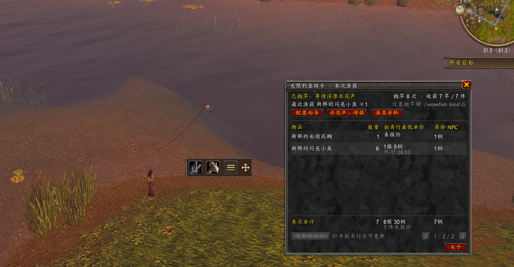

# BobberTally · 无限钓鱼助手

为《魔兽世界：无限》设计的钓鱼插件。用工具栏切换装备和抛竿，查看本次渔获的估价，并在资料库里查找鱼类、钓点和烹饪配方。

*A fishing add-on for World of Warcraft: Forever with gear swaps, catch tracking, and a fish and cooking catalog.*

**[下载 v0.5.15 ZIP](https://bluexp.github.io/bobber-tally/downloads/BobberTally-v0.5.15.zip)** · [中文安装指南](https://bluexp.github.io/bobber-tally/) · [English installation guide](https://bluexp.github.io/bobber-tally/en/)

适用客户端接口 `16001`。插件界面支持简体中文和英文。

## 功能

| 功能 | 游戏内操作 |
| --- | --- |
| 钓鱼工具栏 | 点击装备图标换装，点击鱼钩抛竿。按住四向箭头拖动工具栏。 |
| 渔获估价 | 查看抛竿次数、渔获数量、拍卖行估价和 NPC 售价。打开拍卖行后可手动更新报价，即使本次还没有渔获也能查询资料库价格。 |
| 鱼类与烹饪资料库 | 搜索 88 条鱼类记录和 24 条配方。点击参考钓点打开对应地区的地图。 |

## 安装与配置

1. 解压 ZIP，将 `WowfFishing` 文件夹放入 `_forever_/Interface/AddOns/`。
2. 重启游戏，在角色选择界面的插件列表中启用「无限钓鱼助手」或「BobberTally」。
3. 进入游戏后输入 `/wowfish setup`，按向导选择鱼竿、记录要换回的武器并设置换装快捷键。
4. 如需用同一个键抛竿和收竿，在渔获面板点击「设置抛竿 / 收竿键」，并在游戏设置里开启「交互键」。

## 语言 / Language

默认跟随客户端语言，也可以为当前角色单独设置。选择后输入 `/reload` 生效。

The add-on uses the client language by default. Choose a language for the current character with the commands below, then enter `/reload`.

| 命令 / Command | 界面语言 / Interface language |
| --- | --- |
| `/wowfish lang zh` | 简体中文 / Simplified Chinese |
| `/wowfish lang en` | 英文 / English |
| `/wowfish lang auto` | 跟随客户端 / Client default |

游戏原生物品提示及装备链接沿用客户端语言。

## 常用命令

| 命令 | 用途 |
| --- | --- |
| `/wowfish` 或 `/wowfish loot` | 打开本次渔获和估价面板 |
| `/wowfish setup` | 打开换装配置向导 |
| `/wowfish fish` | 打开鱼类与烹饪资料库 |
| `/wowfish bind G` | 绑定抛竿和收竿，`G` 可换为空闲键 |
| `/wowfish about` | 查看插件内说明与致谢 |

## 实机预览

v0.5.7 实机截图，展示钓鱼工具栏和渔获面板。

## 数据与致谢

设置、拍卖行报价和实钓记录按角色保存在本地。报价反映查询时的挂单，资料库会标注参考钓点的来源和角色的实钓记录。

[完整使用说明与资料来源](addons/WowfFishing/README.md) · [第三方授权](addons/WowfFishing/THIRD_PARTY_LICENSES.txt) · [使用规则与代码审查](COMPLIANCE.md)
