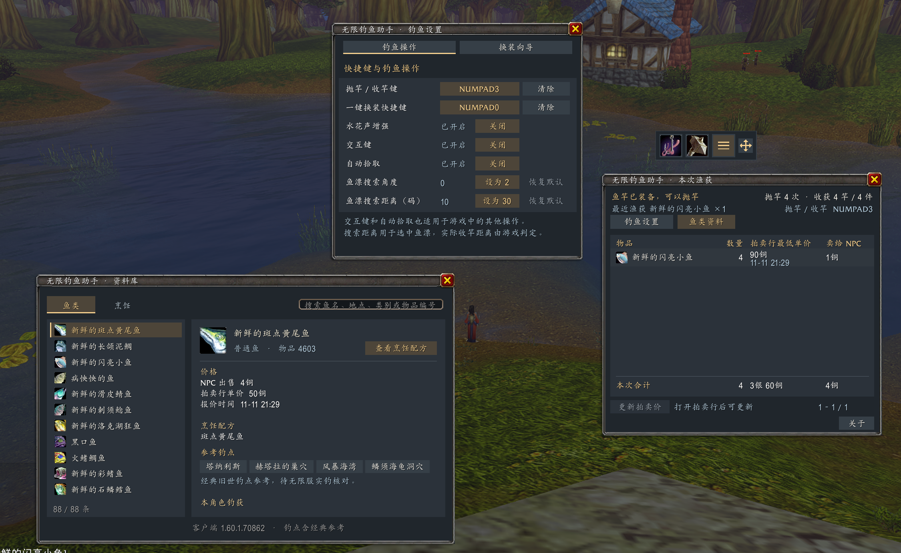

# BobberTally · 无限钓鱼助手

**简体中文** · [English](README.en.md)

为《魔兽世界：无限》设计的钓鱼插件。用工具栏切换装备和抛竿，查看本次渔获的估价，并在资料库里查找鱼类、钓点和烹饪配方。

*A fishing add-on for World of Warcraft: Forever with gear swaps, catch tracking, and a fish and cooking catalog.*

**[下载 v0.11.4 ZIP](https://github.com/bluexp/bobber-tally/releases/download/v0.11.4/BobberTally-v0.11.4.zip)** · [无限库 WFDB 中文安装指南](https://wfdb.cc/addons/bobber-tally/) · [English installation guide](https://wfdb.cc/en/addons/bobber-tally/)

适用客户端接口 `16001`。插件界面支持简体中文和英文。

BobberTally 是「[无限库 WFDB](https://wfdb.cc/)」的游戏内组件。WFDB 的[钓鱼数据库](https://wfdb.cc/fishing/)提供钓点、配方与投稿预览，[Mac 客户端](https://wfdb.cc/downloads/#macos)提供插件安装、更新与记录整理。

## 许可与署名

本项目原创插件代码及配套文档采用 [BobberTally 非商业使用及署名许可协议 1.0](LICENSE)：**禁止商用；允许非商业个人使用、学习、修改和免费分享，须保留作者与出处。**个人本地使用保留随附声明即可；公开分享或修改版须注明 `BobberTally · 原作者 bluexp · https://github.com/bluexp/bobber-tally`，修改版另标改动并随包提供完整可读源码。

这是自定义的**源码可用许可**，含非商业限制，不是 OSI 开源许可。完整适用范围及义务以协议为准，其他 WFDB 产品不在该授权内。FishDex 数据继续适用 MIT 等原第三方授权；新协议仅覆盖明确随附它的副本，既有发布 ZIP 和标签保持原样。[署名声明](NOTICE) · [许可问答与商用边界](addons/WowfFishing/LICENSING.md) · [贡献须知](CONTRIBUTING.md)

## 功能

| 功能 | 游戏内操作 |
| --- | --- |
| 钓鱼工具栏 | 点击装备图标换装，点击鱼钩抛竿。柱状图打开渔获统计，齿轮打开设置。按住四向箭头拖动工具栏。 |
| 换装方案 | 查看主副手和最近一次换装结果。插件确认两处装备都达到目标后才显示成功，失败时会说明原因。 |
| 统一钓鱼设置 | 集中管理换装和抛竿快捷键、水花声增强、交互键、自动拾取和鱼漂搜索。支持小键盘与鼠标侧键。 |
| 渔获估价 | 查看抛竿次数、渔获数量、钓鱼用时、两种估价及每小时统计。「打开拍卖行自动查价」默认开启，可在「钓鱼操作」关闭，也可手动更新拍卖价。 |
| 我的挂单 | 查看鱼类在售、已售和每日记录，成交时收到提醒。打开邮箱同步实际结算所得。 |
| 渔获与烹饪资料库 | 搜索 89 条渔获记录和 24 条配方。按当前区域或「非鱼类水产」筛选，查看钓点来源并打开地图，也可设置捕获目标。 |

## 安装与配置

1. 解压 ZIP，将 `WowfFishing` 文件夹放入 `_forever_/Interface/AddOns/`。
2. 重启游戏，在角色选择界面的插件列表中启用「无限钓鱼助手」或「BobberTally」。
3. 输入 `/wowfish setup`，选择鱼竿和要换回的武器，再录入换装键。向导会在游戏确认装备后继续。
4. 打开「钓鱼设置 → 钓鱼操作」，录入抛竿 / 收竿键并开启「交互键」。录入鼠标侧键时，把鼠标停在录入按钮上再按侧键。

游戏已绑定的键可以直接录入。插件临时使用该键，换键或点击「清除」后恢复原操作。如果两个插件动作录入同一个键，以最后保存的为准。

## 语言 / Language

默认跟随客户端语言，也可以为当前角色单独设置。选择后输入 `/reload` 生效。

The add-on uses the client language by default. Choose a language for the current character with the commands below, then enter `/reload`.

| 命令 / Command | 界面语言 / Interface language |
| --- | --- |
| `/wowfish lang zh` | 简体中文 / Simplified Chinese |
| `/wowfish lang en` | 英文 / English |
| `/wowfish lang auto` | 跟随客户端 / Client default |

游戏原生物品提示及装备链接沿用客户端语言。

## 常用命令

| 命令 | 用途 |
| --- | --- |
| `/wowfish` 或 `/wowfish loot` | 打开本次渔获和估价面板 |
| `/wowfish setup` | 打开换装配置向导 |
| `/wowfish gear` | 查看换装方案和最近一次结果 |
| `/wowfish settings` | 打开统一钓鱼设置 |
| `/wowfish auctions` | 查看在售挂单、成交和每日记录 |
| `/wowfish fish` | 打开鱼类与烹饪资料库 |
| `/wowfish export` | 导出近期实钓记录，可在 WFDB 钓鱼数据库预览 |
| `/wowfish bind G` | 绑定抛竿和收竿，`G` 可换为你想使用的键 |
| `/wowfish about` | 查看 WFDB 网站地址、插件说明与致谢 |

## 实机预览

v0.6.0 实机截图：统一钓鱼设置、本次渔获和鱼类资料库可同时打开，统一使用深色界面。

## 数据与致谢

本次渔获在重新登录或重载界面后保留，可点「结束本次」清零。设置、拍卖行报价、成交与结算记录和实钓记录按角色保存在本地。报价反映查询时的挂单，资料库会标注参考钓点的来源和角色的实钓记录。

[完整使用说明与资料来源](addons/WowfFishing/README.md) · [第三方授权](addons/WowfFishing/THIRD_PARTY_LICENSES.txt) · [使用规则与代码审查](COMPLIANCE.md)
